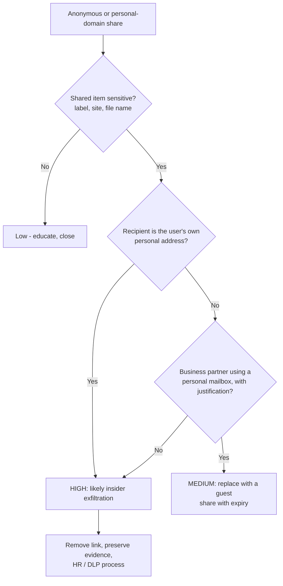

# External Sharing / Anonymous Links

> An "Anyone with the link" share or a share to a personal address (gmail, outlook.com and so on) moves data outside your control in one click, **with no download events to see later**. Decide whether it is business collaboration or exfiltration, and whether the data is sensitive.

## When this fires
- `m365_anonymous_link_created` / `anonymous-link-created`: `AnonymousLinkCreated` / `AnonymousLinkUsed` in SharePoint or OneDrive
- `m365_sharing_with_personal_domain` / `sharing-with-personal-domains`: `SharingInvitationCreated` / `AddedToSecureLink` targeting a consumer email domain

## Triage decision tree


## Investigation steps
1. List the user's sharing activity:
   ```kql
   let upn = "<USER_UPN>";
   OfficeActivity
   | where TimeGenerated > ago(14d) and UserId =~ upn
   | where Operation in ("AnonymousLinkCreated", "AnonymousLinkUsed", "SharingInvitationCreated", "AddedToSecureLink", "SecureLinkCreated")
   | project TimeGenerated, Operation, SourceFileName, Site_Url, TargetUserOrGroupName, ClientIP
   ```
2. Check whether the anonymous link was **used**, and from where (`AnonymousLinkUsed` with ClientIP).
3. Compare the recipient with the user's own name. A share to `firstname.lastname@gmail.com` is the classic self-exfiltration signal.
4. Check sensitivity labels and DLP matches on the shared items.

## True vs false positive

| Points to exfiltration | Points to benign |
|---|---|
| Share to the user's own personal mailbox | Partner on a consumer domain with a ticket |
| Bulk sharing of many files in a short window | One marketing asset shared publicly by design |
| Confidential label, HR / finance folder | Public collateral site |

## Containment & response
- Remove the anonymous link or external permission (SharePoint admin, or `Remove-PnPFileSharingLink`).
- Set tenant defaults: link type *Specific people*, expiry on anonymous links, and block anonymous links for sensitive sites.
- Apply DLP policies that block external sharing of labelled content.
- Insider pattern: follow your HR / legal process and preserve the audit trail.

## Escalation criteria
Sensitive data shared to a personal account, link used from unknown IPs, or bulk sharing → DLP / insider risk team; with regulated data → IR and privacy.

## Evidence to collect
Sharing audit records, file list with labels, link-usage records, and the recipient identity.
