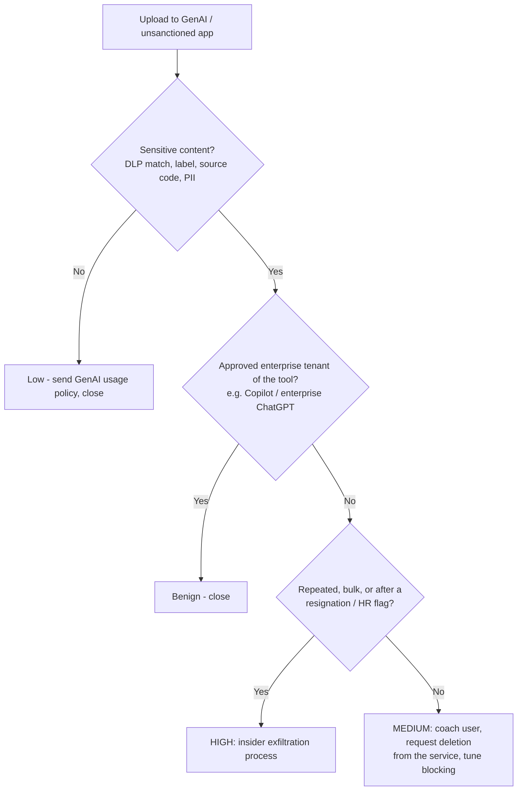

# Data Upload to GenAI or Unsanctioned Cloud Apps

> Users paste source code, customer data or contracts into public GenAI chatbots, or upload files to personal cloud storage and file-transfer sites. Most of it is well-meant productivity, but **regulated or secret data leaving to a service with no contract is still a data breach**.

## When this fires
- `dlp_personal_cloud_upload`: DLP detected sensitive content uploaded to a personal cloud or unsanctioned app
- `upload-to-unsanctioned-app`: Defender for Endpoint / Cloud Apps recorded uploads to apps tagged *Unsanctioned* (including GenAI apps not approved by the organization)
- `unsanctioned-app-blocked`: a user repeatedly tried to reach a blocked app, which shows intent or a business need nobody has addressed

## Triage decision tree


## Investigation steps
1. What went where:
   ```kql
   let upn = "<USER_UPN>";
   CloudAppEvents
   | where TimeGenerated > ago(7d)
   | where AccountId =~ upn or AccountDisplayName has upn or tostring(RawEventData.UserId) =~ upn
   | where ActionType has_any ("Upload", "FileUploaded", "Paste")
   | summarize Events = count(), Objects = make_set(ObjectName, 20) by Application, IPAddress
   ```
2. Check DLP: sensitive information types matched, file names and labels. For browser paste events, use Endpoint DLP / Purview DSPM for AI activity explorer.
3. Determine the tool's status: sanctioned enterprise tenant (data not used for training, under contract) or a consumer account.
4. Look at the pattern: one-off curiosity, or a steady stream of internal documents?

## True vs false positive

| Points to a real data incident | Points to benign |
|---|---|
| Customer PII, credentials, keys or source code pasted into a consumer chatbot | Public information or marketing copy |
| Consumer file-transfer site after a resignation | Approved enterprise GenAI tenant |
| Large archives uploaded off-hours | Personal photo upload to personal storage, no company data |

## Containment & response
- Ask the user to delete the conversation or file, and request deletion from the provider where possible. Record the outcome.
- If secrets were exposed (API keys, passwords, tokens): **rotate them immediately**.
- Tag the app as Unsanctioned in Defender for Cloud Apps (blocks via MDE network protection), or allow only enterprise tenants through tenant restrictions.
- Publish an approved GenAI option. Blocking without an alternative drives shadow IT.

## Escalation criteria
Regulated data (PCI, PHI, PII), secrets, or a deliberate insider pattern → privacy / insider-risk team and IR.

## Evidence to collect
Activity records (app, action, object), DLP matches, user statement, and the deletion confirmation.
