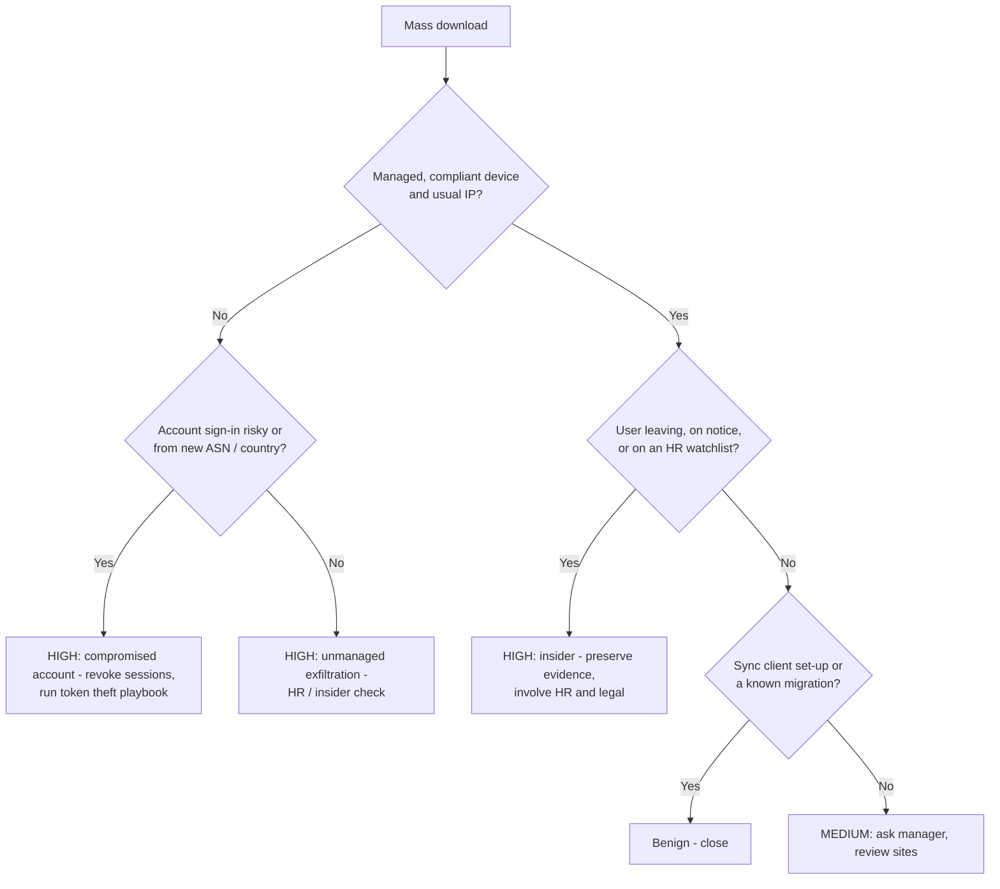

# Mass Download from SharePoint / OneDrive / SaaS

> One identity downloaded or synced an unusual number of files in a short window. Three stories fit: a departing employee, a compromised account harvesting data, or a sync client doing its job. **Who, from which device, and which sites?**

## When this fires
- `m365_mass_file_download` / `m365-mass-file-download`: `FileDownloaded` / `FileSyncDownloadedFull` above threshold for one user
- `mdca_mass_download` / `mass-download-saas`: Defender for Cloud Apps mass-download anomaly or high CloudAppEvents download count
- `mass-file-access-sensitive-sites`: high access volume on sites in the `SensitiveSites` watchlist

## Triage decision tree


## Investigation steps
1. Volume by site, client and IP:
   ```kql
   let upn = "<USER_UPN>";
   OfficeActivity
   | where TimeGenerated > ago(2d) and UserId =~ upn
   | where Operation in ("FileDownloaded", "FileSyncDownloadedFull", "FileAccessed")
   | summarize Files = dcount(OfficeObjectId), Sites = make_set(Site_Url, 20), Agents = make_set(UserAgent, 5)
       by ClientIP, bin(TimeGenerated, 1h)
   | order by Files desc
   ```
2. Classify the data: are the sites or labels sensitive (sensitivity labels, `SensitiveSites` watchlist, HR / finance / legal)?
3. Check the device: Entra device ID and compliance in SigninLogs (`DeviceDetail.isCompliant`), and whether it is a personal machine or browser.
4. Follow the data: USB copies, uploads to personal cloud or GenAI tools, and email to personal domains from the same user afterwards ([DLP](../data/dlp-exfiltration.md), [USB](../data/usb-removable-media-exfiltration.md)).
5. SecOps pivot:
   ```
   metadata.product_event_type = "FileDownloaded" AND principal.user.email_addresses = "<USER_UPN>"
   ```

## True vs false positive

| Points to exfiltration | Points to benign |
|---|---|
| Unmanaged device, rclone/curl/python user agent, or a new ASN | OneDrive sync set-up on a new corporate laptop |
| Sensitive or out-of-role sites | The user's own team site |
| User resigned or on notice | Approved migration or archive project |

## Containment & response
- Compromised account: revoke sessions, reset the password, and block the IP.
- Insider: involve HR and legal **before** confronting the user; preserve audit logs; restrict access (Conditional Access app-enforced restrictions, block download on unmanaged devices).
- Review sharing links created by the user in the same window ([external sharing](external-sharing-anonymous-links.md)).

## Escalation criteria
Regulated or crown-jewel data, an unmanaged destination, or a compromised account → IR. Insider cases → HR / legal per policy.

## Evidence to collect
Download audit records with file IDs and names, device and sign-in details, site sensitivity, and any onward-transfer evidence.
