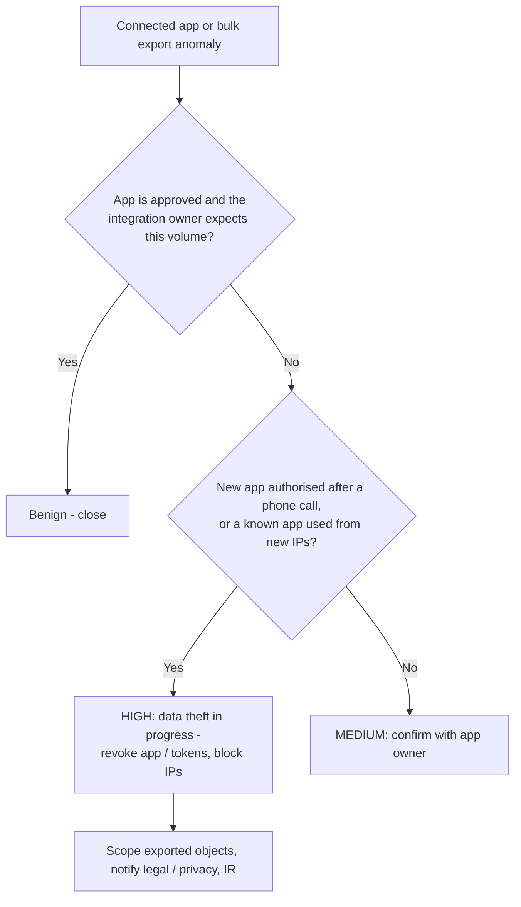

# SaaS Connected-App Data Theft (Salesforce and Similar)

> In 2025 attackers stole customer data from many Salesforce tenants without touching a single endpoint. In one pattern, **vishing calls** talked employees into authorising a modified "Data Loader" connected app. In another, **OAuth tokens of a third-party integration** were stolen and used to query tenants directly. SaaS platforms trust connected apps, so the defence is governing them and watching their API usage.

## When this fires
- `mdca_high_severity_alert`: Defender for Cloud Apps / app governance alerts (unusual OAuth app activity, mass data access)
- `mdca_mass_download` / `mass-download-saas`, `oauth-app-mass-access`: high-volume API or export activity by a user or app
- Platform signals: new connected app authorised, Bulk API / report exports, logins from unusual IPs to Salesforce, ServiceNow, Workday and similar

## Triage decision tree


## Investigation steps
1. SaaS app activity by account, app and IP (Defender for Cloud Apps connector):
   ```kql
   CloudAppEvents
   | where TimeGenerated > ago(7d) and Application in ("Salesforce", "ServiceNow", "Workday", "Box", "Dropbox", "Okta")
   | summarize Events = count(), Actions = make_set(ActionType, 30), IPs = make_set(IPAddress, 20) by Application, AccountDisplayName, UserAgent
   | order by Events desc
   ```
2. In the SaaS platform: connected-app authorisations (Salesforce *Connected Apps OAuth Usage*), login history, and API / Bulk API / report export events (Event Monitoring) during the window.
3. For third-party integrations: check the vendor's advisory, list the integration's tokens and the queries made with them, and look for secrets inside exported records (AWS keys and passwords stored in support-case fields were harvested in 2025).
4. Interview users who authorised new apps: was there a call from "IT support"?

## True vs false positive

| Points to attack | Points to benign |
|---|---|
| "Data Loader" style app authorised minutes after a helpdesk phone call | Integration owner running a planned data migration |
| Integration token used from VPS / Tor IPs | Vendor API calls from the vendor's published ranges |
| Bulk export of Accounts / Contacts / Cases objects in hours | Nightly sync with a stable volume |

## Containment & response
- Revoke the connected app and its OAuth tokens; block the source IPs; reset affected users.
- Rotate any secrets found in exported records (keys and passwords in tickets and cases).
- Govern connected apps: admin approval required, allowlist approved apps, IP restrictions and login-IP ranges for API users, Event Monitoring streamed to the SIEM, and MFA for all SaaS logins.
- Assess notification duties for exported customer data.

## Escalation criteria
Any confirmed export by an unknown app or stolen token → IR, legal and privacy.

## Evidence to collect
Connected-app authorisation records, API and export logs, login history, list of exported objects and record counts.
