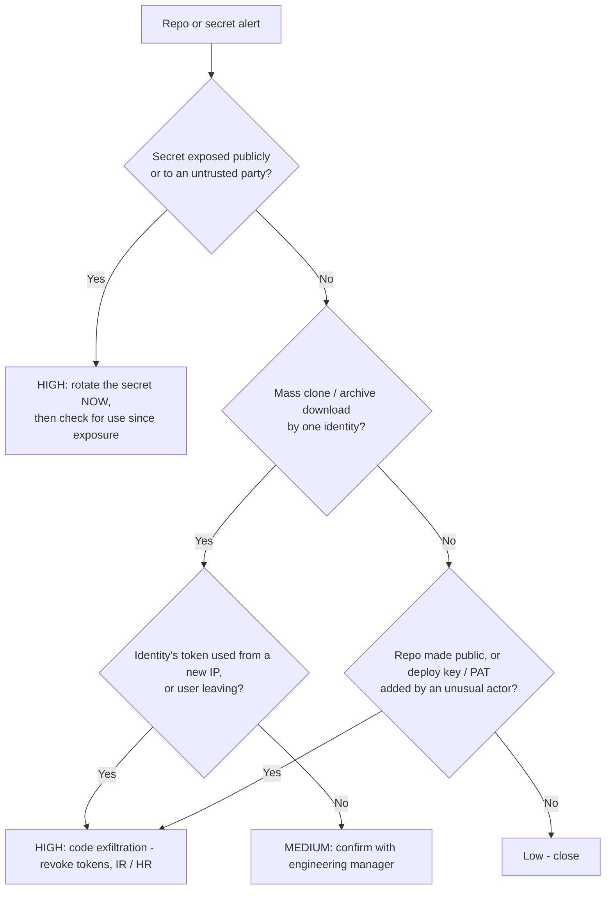

# Source Code Exfiltration and Secret Exposure

> Source code repositories hold your intellectual property and, far too often, **hard-coded secrets**. Two scenarios matter: an attacker (or departing insider) cloning many repositories, and a secret pushed to a public repository, where bots harvest it **within minutes**. Rotating the secret matters more than deleting the commit.

## When this fires
**Hunt-driven**, plus platform alerts: GitHub / GitLab / Azure DevOps audit events (repository visibility changed to public, mass clone, new deploy keys, PATs, org members), and secret-scanning or push-protection alerts.

## Triage decision tree


## Investigation steps
1. Repository platform activity (GitHub via the Defender for Cloud Apps connector):
   ```kql
   CloudAppEvents
   | where TimeGenerated > ago(14d) and Application has "GitHub"
   | where ActionType has_any ("clone", "download", "visibility", "repo.access", "deploy_key", "personal_access_token", "org.add_member", "secret_scanning")
   | summarize Events = count(), Actions = make_set(ActionType, 20), Repos = make_set(ObjectName, 30), IPs = make_set(IPAddress, 10) by AccountDisplayName
   | order by Events desc
   ```
   If you stream the GitHub audit log directly, the equivalent events are `git.clone`, `repo.access` (visibility), `repo.download_zip`, `public_key.create` and `personal_access_token.*`.
2. For an exposed secret: what it unlocks, when it was first exposed (commit time), and whether it was used since: cloud API calls by the key ([stolen key enumeration](../cloud/stolen-key-enumeration.md)), database logins, SaaS API usage.
3. For mass cloning: token or SSH key used, source IP, the identity's normal repositories, and HR status.
4. Check CI/CD for the same token ([pipeline tampering](../cloud/cicd-pipeline-secret-tampering.md)).

## True vs false positive

| Points to attack | Points to benign |
|---|---|
| 200 repos cloned overnight by a token from a VPS | New engineer onboarding, cloning team repos from the office |
| Private repo switched to public by an account outside engineering | Planned open-source release with approval |
| Valid AWS key in a public commit | Test key from documentation (verify it is inert) |

## Containment & response
- **Rotate exposed secrets first** (deleting the commit does not help, because forks, caches and bots already have it); then purge them from history if needed.
- Revoke the PAT, SSH key or OAuth token used for exfiltration; remove unknown deploy keys and members.
- Prevent: push protection and secret scanning on all repositories, fine-grained short-lived tokens, SSO enforcement, IP allowlists for the organization, and audit-log streaming to the SIEM.

## Escalation criteria
Live secrets exposed, a production key used by a third party, or confirmed code exfiltration → IR (and HR for insiders).

## Evidence to collect
Audit-log events, secret-scanning alerts, commit details, token metadata, usage of the exposed secret.
