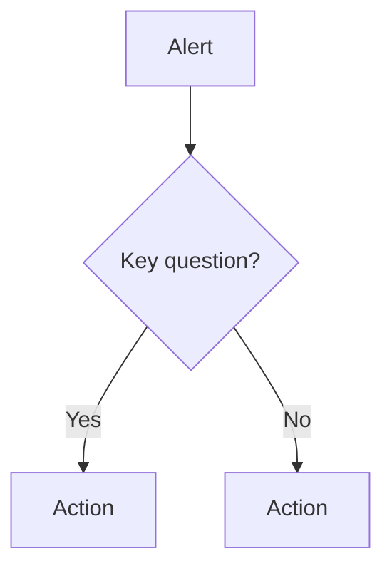

# Playbook Title

> One or two sentences: what is happening and the single question that matters most.

## When this fires
- `secops_rule_one` / `sentinel-rule-one`: what the detection looks for

## Triage decision tree


## Investigation steps
1. Step with a Sentinel query:
   ```kql
   let host = "<DEVICE_NAME>";
   DeviceProcessEvents
   | where TimeGenerated > ago(1d) and DeviceName startswith host
   ```
2. Step with a Google SecOps UDM search:
   ```
   principal.hostname = "<HOST>"
   ```

## True vs false positive

| Points to attack | Points to benign |
|---|---|
| Indicator | Indicator |

## Containment & response
- Action

## Escalation criteria
When to escalate and to whom.

## Evidence to collect
What to preserve.
