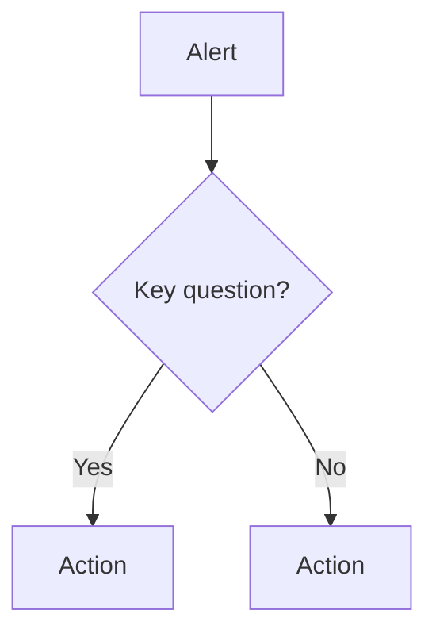

# Playbook Title

> One or two sentences: what is happening and the single question that matters most.

## Triage decision tree


## Investigation steps
1. Step with a UDM search query:
   ```
   principal.hostname = "<HOST>"
   ```

## Containment & response
- Action

## Escalation criteria
When to escalate and to whom.

## Evidence to collect
What to preserve.
